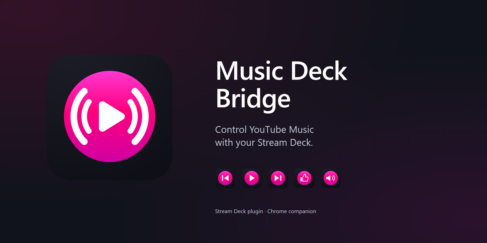
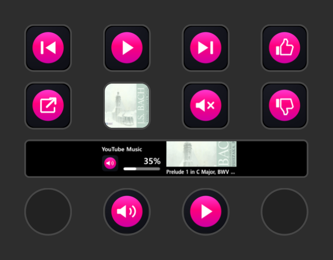
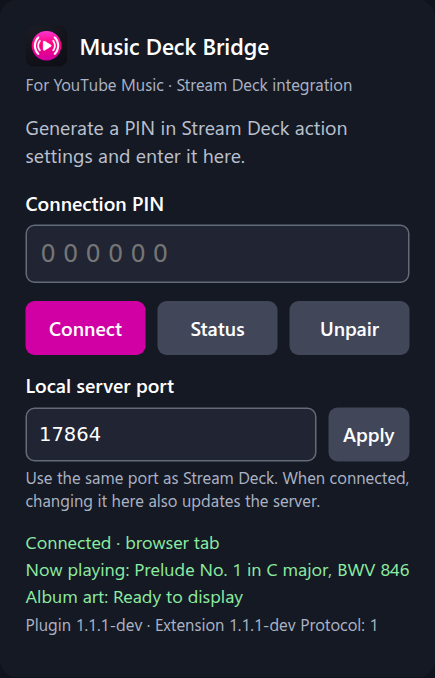
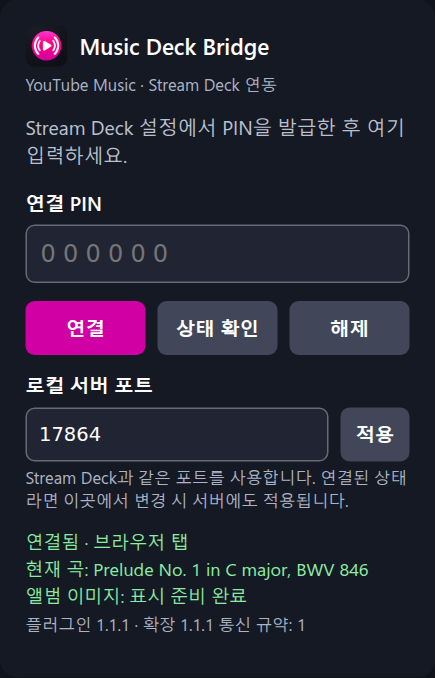

# Music Deck Bridge



Control YouTube Music from Elgato Stream Deck using a Chrome extension.

[한국어 설치 안내](docs/installation.ko.md) · [Installation](docs/installation.en.md) · [Troubleshooting](docs/troubleshooting.md)

Music Deck Bridge contains two components that must be installed together: a Stream Deck plugin that runs a local bridge, and a Chrome extension that reads and controls the YouTube Music web player. It works with a normal Chrome tab or the YouTube Music app installed through Chrome (PWA).

## Installation

**Install the Stream Deck plugin from [Elgato Marketplace](https://marketplace.elgato.com/product/music-deck-bridge-044e81d9-9671-4277-bcb9-ce8b6d38c3fd) and the Chrome extension from [Chrome Web Store](https://chromewebstore.google.com/detail/ldipcjgadbppphalmibkofhigjffnlca).** Add both components, then complete PIN pairing. No separate Node.js, npm or Python installation is needed: Stream Deck provides the plugin runtime. Prebuilt packages are also available from [GitHub Releases](https://github.com/minjungw00/music-deck-bridge/releases/latest).

| Method | Audience and availability | Instructions |
| --- | --- | --- |
| Official stores | Recommended for general users; Elgato Marketplace and Chrome Web Store | [English](docs/installation.en.md#method-1-official-stores) / [한국어](docs/installation.ko.md#method-1-official-stores) |
| GitHub Releases | General users; stable prebuilt packages | [English](docs/installation.en.md#method-2-github-releases) / [한국어](docs/installation.ko.md#method-2-github-releases) |
| GitHub Actions | Testers; latest development packages, stability not guaranteed; GitHub sign-in required | [English](docs/installation.en.md#method-3-github-actions) / [한국어](docs/installation.ko.md#method-3-github-actions) |
| Build from source | Developers; requires Node.js 24 and npm, plus Python 3.10+ for packaging | [English](docs/installation.en.md#method-4-build-from-source) / [한국어](docs/installation.ko.md#method-4-build-from-source) |

See the guides for [PIN pairing](docs/installation.en.md#pairing), [updates](docs/installation.en.md#updating), switching installation methods and removal. If using a Chrome ZIP, extract it to a permanent folder and load it unpacked in Developer mode.

Public releases and development builds are tracked separately in [release readiness](docs/release-readiness.md). The current source targets **1.1.3-dev**; its changes are not yet an official release. Use build metadata to identify development revisions.

## Requirements

| Component | Supported target |
| --- | --- |
| OS | Windows 10 / 11 |
| Browser | Google Chrome 116+ |
| Stream Deck software | 7.1+ (provides Node.js 24) |
| Device | Key actions target Stream Deck key models; encoder actions require Stream Deck + |
| Languages | English / 한국어 |

## Features

- Current song, artist and album artwork on a key; choose text visibility, artist placement, background and scrolling. Press to play or pause.
- Play/pause, previous track, next track and mute keys.
- Open YouTube Music from a dedicated key; other controls open a missing player and continue their requested action when ready.
- Like/dislike the current song, with selected-state icons; press again to remove the rating.
- Volume dial with 1–5 percentage points per tick; push or touch to mute.
- Current Track Dial: turn for previous/next track (up to five per event), push or touch to play/pause, and choose song info or fitted album artwork with optional song/artist text.
- English and Korean settings; truncated or scrolling track titles.
- Six-digit PIN pairing, an authenticated loopback bridge, a configurable shared port and protocol compatibility checks with targeted update guidance.
- Preference for an installed Chrome app when both an app and browser tab are open.

## Product images

Stream Deck + capture:



English and Korean Chrome extension popup previews with sample playback data:

<p>
  
  
</p>

## Development

Install Node.js 24, then run:

```sh
npm ci --ignore-scripts
npm run check
npm test
```

`npm run build:plugin` needs only Node.js and npm. Packaging uses Python 3.10+ (`python3`, `python`, or Windows `py`). See [development and release checks](docs/development.md) for source builds, tests and packaging. The [documentation index](docs/README.md) separates guides from release and verification records.

```text
streamdeck/        Plugin source, bundle/resources and icon generator
chrome-extension/ Chrome Manifest V3 extension and en/ko locales
tests/            Node.js regression tests and Python packaging tests
scripts/          Validation and packaging tools
docs/             Architecture, installation and development guides
store-assets/     Store submission assets and checklists
```

## Privacy, security and license

Playback data travels between the extension and `127.0.0.1`; the plugin also downloads artwork from approved Google/YouTube image servers. See [privacy](PRIVACY.md), [security reporting](SECURITY.md), [third-party notices](THIRD_PARTY_NOTICES.md) and [contribution guidelines](CONTRIBUTING.md).

Project code and generated project icons are licensed under [Apache-2.0](LICENSE). See the [brand guide](docs/branding.md) for artwork and reproduction details. Bundled third-party code retains its own license.

This is an independent, unofficial project, unaffiliated with Google, YouTube, Elgato or Corsair. Their names identify compatible products and remain the property of their respective owners.
