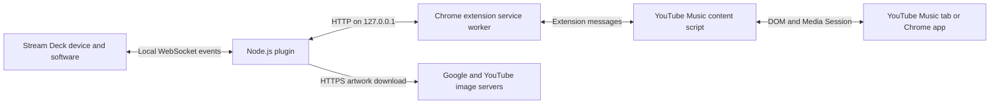

# Architecture

The Stream Deck manifest launches `streamdeck/io.github.minjungw00.musicdeckbridge.sdPlugin/bin/plugin.js` with the local WebSocket registration arguments. It bundles the official `@elgato/streamdeck` 3.0.2 SDK, which owns registration, event routing and display/inspector output. The ten `SingletonAction` registrations forward events to the existing local bridge. The runtime does not load the manifest itself; the SDK handles protected manifests. Source is in `streamdeck/src/plugin.cjs`; esbuild produces the standalone deployed bundle. The property inspector bundles sdpi-components v4.0.1 locally for offline settings UI. Stream Deck passes its language to the plugin/settings; Chrome resolves the extension's en/ko catalogs independently.

## Pairing and requests

1. A Stream Deck action's settings generates a six-digit PIN valid for ten minutes.
2. The extension popup asks its service worker to POST `/pair` with that PIN. The plugin requires an origin matching `chrome-extension://[a-p]{32}` and limits failed PIN attempts to five per minute.
3. A successful pairing creates a random 32-byte token. The plugin persists the token and extension origin; the extension stores the token locally. A new pairing replaces the old pair, rejects existing command polls with HTTP 401, and clears player state and queued commands. The new auth file is written through an atomic replacement.
4. All subsequent routes require both the saved origin and token to access data or controls. A credential-free `/status` request still receives HTTP 401; from the saved origin, it can mark an absent extension credential record and cancel undelivered inputs when no authenticated browser poll is active. It cannot delete credentials, read state, execute commands or displace a live authenticated browser poll. Normal website origins are rejected. This boundary does not protect against malicious software already running as the same OS user.

| Route | Purpose |
| --- | --- |
| `/pair` | Exchange a PIN for a token |
| `/unpair` | Revoke the authenticated pair, delete auth.json and reject pending polls |
| `/status` | Show connection/player/artwork status |
| `/sync` | Submit a tab's current state and receive queued commands |
| `/listen` | Wait up to 12 seconds for player commands |
| `/browser-listen` | Wait for a launch/playback request even when no player tab exists |
| `/browser-result` | Acknowledge a delivered browser request |
| `/player-closed` | Remove a closed tab's player state and end its legacy polls |
| `/configure-port` | Change the shared port while preserving authentication |

The content script reads player DOM/Media Session metadata and current-song rating state and exchanges messages with the service worker, which adds the token to loopback requests. The service worker restricts local storage to `TRUSTED_CONTEXTS` on every start and waits for that restriction before reading tokens or making authenticated requests. The content script does not receive the bearer token. Unpair removes the Chrome token only after server revocation or an HTTP 401 indicating it is already invalid; a network/server failure retains credentials for retry. The extension operates only on `music.youtube.com`; no Google login credentials or remote debugging port are needed.

Volume and mute commands use the site's own controls. The service worker executes a fixed function in the sending tab's top-level `MAIN` world to access the site's slider properties, set its value and dispatch its `change` event, or click its mute button. This lets YouTube Music apply its own volume curve and saved state. Both desktop and compact sliders use a one-point step when controlled by the dial. Commands run in order, and the dial reads the site's displayed percentage through `aria-valuenow`, so manual site adjustments are also reflected. Missing controls leave playback volume unchanged. The existing `scripting` permission is used; no pairing token is passed into the page.

Chrome documents the separation between [isolated content scripts and the page's JavaScript environment](https://developer.chrome.com/docs/extensions/develop/concepts/content-scripts#work_in_isolated_worlds).

Test-only `/__test/*` routes and deterministic PIN/port overrides are enabled only with `MUSIC_DECK_BRIDGE_DEV_TEST=1`. Do not set that environment variable for ordinary Stream Deck use.

## Player selection and state

The plugin prioritizes an installed Chrome app over a browser tab. State is periodically refreshed and remains eligible for 90 seconds to accommodate idle throttling; slower media updates can be marked stale. Tab-close notifications remove its state immediately, and authenticated browser polls reconcile current tab IDs after browser/worker restart. In-flight sync settles before the close notification so old state cannot overwrite it. Legacy commands target the selected client, expire after five seconds and are delivered once through long polling or a sync response. Startup/update/alarm handlers reinject the guarded content script into open player tabs.

The Play / Pause key displays a Pause image while the selected player is playing or buffering, otherwise a Play image. A fixed `MAIN`-world function reads the site player's playback/mute state before metadata sync; media-element state is the fallback. This avoids treating an inactive media element as the active player. The Volume Dial touch-strip icon likewise uses the confirmed mute state, switching between the existing volume and mute artwork and restoring volume artwork when the player disappears. It uses the reported player state rather than optimistically toggling on key presses. Without an eligible player it displays Play. Play/Pause, Like, Dislike and Open keys hide default titles and clear previously pushed runtime text. Image updates are cached per visible key and reset when the key reappears; all instances follow the same selected player. The action retains its existing single manifest state and toggle command behavior.

The extension service worker maintains one authenticated browser-wide long poll independently of player tabs. Modern connections suppress per-tab HTTP long polls so they cannot consume the browser connection pool and delay authentication checks or command acknowledgments. A 404 from an older plugin enables legacy per-tab polling; metadata continues through periodic sync in both cases. Transient browser-channel failures retry after one second; authentication rejection requires pairing recovery. Open requests focus the selected tab/window or create a music tab. Functional requests open a missing player, wait up to 30 seconds for controls, then execute their input. A newly opened playback request means Play, keeping an already resumed track playing. Existing selected players retain their normal toggle/control behavior. The existing host permission allows querying matching tabs without a broader `tabs` permission; see the [Chrome Tabs API](https://developer.chrome.com/docs/extensions/reference/api/tabs#permissions).

Browser inputs remain in an ordered, bounded queue for at most 45 seconds, including while native Chrome starts. Only duplicate Open requests coalesce. An undelivered queue triggers standard-path Windows Chrome after two seconds without a shell. With stored pairing credentials, native startup passes no URL: the extension selects an existing player or creates the missing music tab after authentication. Without stored credentials, native opening uses the fixed music URL and cannot execute functional inputs. A reported missing extension credential record suppresses automatic launching until authenticated communication resumes. Delivered requests never trigger native fallback. The content script acknowledges execution by request ID, caches completed IDs and explicitly distinguishes not-ready from failed/ambiguous execution. Not-ready responses and Chrome's definite missing-receiver errors are retried; the latter can occur when navigation replaces the document after script injection. Ambiguous lost execution replies are never replayed. Pairing changes clear the queue; the worker rechecks credentials before executing after a wait. Old extensions retain their player-queue controls. Without paired extension credentials, native opening cannot complete functional inputs.

Playback and track commands run through a fixed top-frame `MAIN`-world function. It checks player initialization and any available queue state before dispatching a site control. A restored title or enabled button alone does not establish readiness. It confirms playback/pause, a changed track/queue index, or the site's Previous-to-start behavior before acknowledging success. After a click, confirmation waits for up to ten seconds within the original command deadline. A missing result or site/autoplay error is reported without repeating the click. Browser autoplay restrictions are not overridden.

Like/dislike commands target only `ytmusic-player-bar` rating controls. The content script reports `LIKE`, `DISLIKE`, `INDIFFERENT` or unknown; the plugin renders outlined/filled thumbs from confirmed state. Ratings carry a video ID or normalized title/artist key and are ignored if the current track no longer matches. A launch continuation without an existing player applies the explicit rating input to the restored current song once its controls are ready. The site handles rating persistence and cancelling a repeated rating; the extension does not use a private account API.

Inspector connection state uses active authenticated polls or a three-second gap allowance, rather than retaining a connected label for 45 seconds. The inspector refreshes each second. Failed browser inputs provide bounded reason codes in the inspector and SDK log, without recording tokens or page contents; success clears the inspector error.

Port `17864` is the default; both components accept integers 1024–65535. On a live change the plugin binds the new port first, persists it, notifies clients and retains the old listener for two minutes. Sleeping/offline clients may need the port changed manually. No LAN listener is opened.

Artwork downloads validate the HTTPS host, each redirect, content type and a 2 MB limit. `/status` returns a `coverStatus` code: `missing`, `blocked`, `ready`, `downloading`, `waiting` or `failed`. The Chrome popup translates these codes using its own en/ko catalog; unknown codes use the localized waiting message. See [privacy](../PRIVACY.md) for the allowlist and data lifecycle.

## Plugin identity

The plugin UUID is `io.github.minjungw00.musicdeckbridge`; action UUIDs append an action name, such as `.nowplaying` or `.volume`. The package folder is `io.github.minjungw00.musicdeckbridge.sdPlugin`. Authentication and port configuration are stored under `%APPDATA%\MusicDeckBridge`.

See [release checks](development.md#release-checklist) for distribution requirements.
