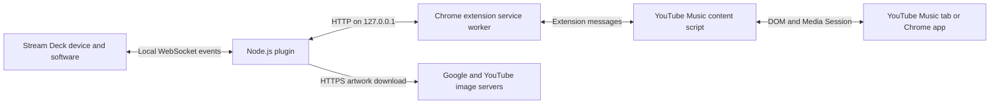

# Architecture

The Stream Deck manifest launches `streamdeck/io.github.minjungw00.musicdeckbridge.sdPlugin/bin/plugin.js` with the local WebSocket registration arguments. It bundles the official `@elgato/streamdeck` 3.0.2 SDK, which owns registration, event routing and display/inspector output. The ten `SingletonAction` registrations forward events to the local bridge. The runtime does not load the manifest itself; the SDK handles protected manifests.

The entry point is `streamdeck/src/plugin.cjs`; esbuild produces the standalone deployed bundle.

The property inspector bundles sdpi-components v4.0.1 locally for offline settings UI. Stream Deck passes its language to the plugin/settings; Chrome resolves the extension's en/ko catalogs independently.

- [Code boundaries](#code-boundaries)
- [Pairing and requests](#pairing-and-requests)
- [Player selection and state](#player-selection-and-state)
- [Display behavior](#display-behavior)
- [Command delivery](#command-delivery)
- [Bridge lifecycle](#bridge-lifecycle)
- [Plugin identity](#plugin-identity)

## Code boundaries

The plugin uses ports and adapters with explicit factories. [plugin.cjs](../streamdeck/src/plugin.cjs) is the composition root: it connects services and starts the HTTP server, SDK and display timers. Importing the supporting modules starts no servers or timers.

| Layer | Responsibility |
| --- | --- |
| [Domain](../streamdeck/src/domain/) | Player normalization/selection, action identities, credential comparison and value validation; no network or file access |
| [Application](../streamdeck/src/application/) | Pairing sessions, player leases, ordered command delivery, port changes and key/dial input handling |
| [Adapters](../streamdeck/src/adapters/) | Loopback HTTP, Stream Deck SDK, atomic file persistence and artwork fetching/cache |
| [Presentation](../streamdeck/src/presentation/) | Key/dial rendering and grapheme-aware text formatting through injected output/artwork ports |

### Plugin services

The command service owns `queued → delivered → succeeded/failed/expired/cancelled` transitions. Its channel port exposes only `reply` and `onClose`; HTTP request/response objects stay in the transport adapter. A delivered command is not replayed after a missing result. A superseded outcome is cancellation, not successful navigation or a key error; older results cannot replace the newest request's diagnostic state.

A session coordinator cancels polls/inputs and resets player/artwork state through explicit service methods. The session service publishes only pairing/access flags and a generation number to command delivery; it does not expose the stored token or assign command error fields.

Credential writes/deletion must succeed before the active pairing is replaced/revoked. A compatible pairing candidate's protocol information is calculated without changing the active session and committed only after its credentials are saved; failed storage preserves the existing compatibility/blocking state, diagnostics and pending inputs. Player selection and command deadlines accept an injected clock for deterministic tests.

### Extension and inspector

[background.js](../chrome-extension/background.js) is the classic MV3 worker entry point. Its [background modules](../chrome-extension/background/) separate the authenticated bridge client, browser-wide command channel, message router and fixed page-control functions. The client owns credential access and protocol state; the channel owns polling/retry and tab delivery. Management and player-sync services own pairing/port workflows and tab state/closure. The router validates message senders and arguments, then dispatches to those services.

`MAIN`-world functions remain self-contained because Chrome serializes them for execution in the page.

The isolated-world content entry point composes metadata, command execution and runtime/lifecycle modules under `content/`. Both manifest loading and reinjection use the manifest’s complete ordered script list.

The inspector keeps its translations and volume editing model separate from DOM/host wiring, preserving pending edits against delayed saved-setting notifications.

The management service serializes pairing, unpairing and port changes through both HTTP completion and local persistence. Status/port reads share that queue so they observe preceding operations; failure releases the queue for subsequent requests. Browser command polling remains independent. The popup applies status/version results only for its latest action and uses a separate port edit revision to protect newer input from delayed reads/save responses.

### Display output

Image/title output caches record a value only when the SDK output promise succeeds. Pending writes serialize per field and coalesce newer values; rejection or a skipped output permits retry on the next repaint. This confirms SDK submission, not physical-device rendering.

Each Current Track Dial retains one in-flight feedback frame and one replaceable pending frame. Unsent intermediate state changes coalesce into the latest frame, including display-mode and artwork changes. Each submitted frame applies its layout before its content. Successful frames are cached; failure permits retry without invalidating a newer successful frame. Disappearing actions discard pending content.

### Shared rendering and fixtures

Rendering tests and the offline preview import the presentation API directly. The preview bundles that API for the browser with local artwork/output adapters. Worker fixtures follow the actual `importScripts` graph, and packaging checks require every imported worker file in the Chrome ZIP.

## Pairing and requests

1. A Stream Deck action's settings generates a six-digit PIN valid for ten minutes.
2. The extension popup asks its service worker to POST `/pair` with that PIN. The plugin requires an origin matching `chrome-extension://[a-p]{32}` and limits failed PIN attempts to five per minute.
3. A successful pairing creates a random 32-byte token. The plugin persists the token and extension origin; the extension stores the token locally. A new pairing replaces the old pair, rejects existing command polls with HTTP 401, and clears player state and queued commands. The new auth file is written through an atomic replacement.
4. All subsequent routes require both the saved origin and token to access data or controls. A credential-free `/status` request still receives HTTP 401; from the saved origin, it can mark an absent extension credential record and cancel undelivered inputs when no authenticated browser poll is active. It cannot delete credentials, read state, execute commands or displace a live authenticated browser poll. Normal website origins are rejected. This boundary does not protect against malicious software already running as the same OS user.

### Compatibility

The [shared protocol contract](protocol.md) reports `pluginVersion` and `extensionVersion` separately from the wire range (`minProtocolVersion` through `protocolVersion`, currently 1–1). Application-version differences are allowed. Missing negotiation fields mean the known legacy-v1 contract; malformed explicit fields are rejected. After authentication/PIN validation, incompatibility returns HTTP 409, blocks launch/control delivery and discards pending inputs while retaining auth/port/settings. Compatible replacement restores communication without a new PIN; explicit unpair remains available. Both UIs identify the component that needs updating.

### HTTP routes

| Route | Purpose |
| --- | --- |
| `/pair` | Exchange a PIN for a token |
| `/unpair` | Revoke the authenticated pair, delete auth.json and reject pending polls |
| `/status` | Show connection/player/artwork status |
| `/sync` | Submit a tab's current state and receive queued commands |
| `/listen` | Wait up to 12 seconds for player commands |
| `/browser-listen` | Wait for a launch/playback request even when no player tab exists |
| `/browser-result` | Acknowledge a delivered browser request |
| `/player-closed` | Remove a closed tab's player state and end its legacy polls |
| `/configure-port` | Change the shared port while preserving authentication |

### Command dispatch and confirmation

An extension can opt into `/browser-listen` with `concurrent: true`. The plugin then delivers queued requests in order with at most eight awaiting final results; each still settles only through its own `/browser-result`. Peers that omit the flag retain one request at a time. An older plugin ignores the optional flag and remains serial.

Within a tab, the content runtime deduplicates request IDs and obtains a document-local operation receipt from the fixed `MAIN` function. A separate result read observes actual completion; receipt alone is never reported as success. The worker resumes polling after receipt, allowing later controls to reach the same document while verification is pending. Lost receivers are retried only before receipt; lost results after receipt are ambiguous and never replay navigation.

The document serializes preparation/clicks, then verifies outcomes independently. A later Play/Pause can interrupt undispatched navigation initialization. Once a newer playback control is dispatched, older verification stops and cannot issue a late Play request. Previous/Next playback recovery does not depend on receiving a seek event, but navigation success still requires observed track/index/restart evidence. The wire protocol remains 1; use both updated components for concurrent delivery.

### Extension credentials and page access

The content script reads player DOM/Media Session metadata and current-song rating state and exchanges messages with the service worker, which adds the token to loopback requests. The service worker restricts local storage to `TRUSTED_CONTEXTS` on every start and waits for that restriction before reading tokens or making authenticated requests. The content script does not receive the bearer token.

Unpair removes the Chrome token only after server revocation or an HTTP 401 indicating it is already invalid; a network/server failure retains credentials for retry. The extension operates only on `music.youtube.com`; no Google login credentials or remote debugging port are needed.

### Volume and mute

Volume and mute commands use the site's own controls. The service worker executes a fixed function in the sending tab's top-level `MAIN` world to access the site's slider properties, set its value and dispatch its `change` event, or click its mute button. This lets YouTube Music apply its own volume curve and saved state.

Both desktop and compact sliders use a one-point step when controlled by the dial. Commands run in order, and the dial reads the site's displayed percentage through `aria-valuenow`, so manual site adjustments are also reflected. Missing controls leave playback volume unchanged. The existing `scripting` permission is used; no pairing token is passed into the page.

Chrome documents the separation between [isolated content scripts and the page's JavaScript environment](https://developer.chrome.com/docs/extensions/develop/concepts/content-scripts#work_in_isolated_worlds).

Test-only `/__test/*` routes and deterministic PIN/port overrides are enabled only with `MUSIC_DECK_BRIDGE_DEV_TEST=1`. Do not set that environment variable for ordinary Stream Deck use.

## Player selection and state

### Player lifecycle

The plugin prioritizes an installed Chrome app over a browser tab. State is periodically refreshed and remains eligible for 90 seconds to accommodate idle throttling; slower media updates can be marked stale. Tab-close notifications remove its state immediately, and authenticated browser polls reconcile current tab IDs after browser/worker restart.

Every in-flight sync for a closing tab settles before its close notification, including overlapping snapshots from different documents and failed requests. The content runtime stops observation/timers on page hide and restarts observation, periodic sync and command listening on cached-page restoration.

Legacy commands target the selected client, expire after five seconds and are delivered once through long polling or a sync response. Startup/update/alarm handlers reinject the guarded content script into open player tabs.

## Display behavior

### Key feedback

The Play / Pause key displays a Pause image while the selected player is playing or buffering, otherwise a Play image. A fixed `MAIN`-world function reads the site player's playback/mute state before metadata sync; media-element state is the fallback. This avoids treating an inactive media element as the active player.

The Volume Dial touch-strip icon likewise uses the confirmed mute state, switching between the existing volume and mute artwork and restoring volume artwork when the player disappears. It uses the reported player state rather than optimistically toggling on key presses.

Without an eligible player the Play / Pause key displays Play. Play/Pause, Like, Dislike and Open keys hide default titles and clear previously pushed runtime text. Image updates are cached per visible key and reset when the key reappears; all instances follow the same selected player. The action retains its existing single manifest state and toggle command behavior.

### Current Track Dial

The Current Track Dial retains the `.trackdial` action UUID. Rotation preserves previous/next inputs; push and touch both toggle playback. Its default `$A1` layout shows the confirmed Play/Pause icon and song name. The per-action `dialDisplay` setting selects `info` or `artwork`.

Artwork uses a 200 × 100 pixmap containing a raster-backed SVG: `artworkFit: height` (default) scales the original height to 100 px, while `width` scales the width to 200 px. The bundled `image-size` header reader supplies PNG/JPEG/WebP dimensions; the SVG explicitly sets the centered image geometry with the original aspect ratio and a fixed viewport for cropping. Text overlay settings are stored per action:

| Setting | Values and defaults |
| --- | --- |
| `artworkShowTitle` | Bottom native text overlay; default `false` |
| `artworkShowArtist` | Include artist; default `false` |
| `artworkArtistPosition` | `inline` (default) or `below` with two full-width rows |
| `artworkTitleBackground` | Black text backdrop; default `false` |
| `artworkTitleMode` | Native ellipsis (`truncate`, default) or grapheme-aware left scrolling (`scroll`) |

Scrolling uses the Now Playing key's 380 ms cadence and initial pause. Dial scroll frames carry the full cyclic string, clipped by the native 200 px field, rather than a fixed glyph window. Text/track changes reset the scroll position; scroll frames update only text.

A separate centered 100 × 100 playback icon handles missing/pending artwork. Layout changes precede content updates through a per-instance queue. Cached images are resent only when the source, fit or layout changes; title changes update text independently. Volume Dial push and touch both toggle mute.

### Now Playing key

The Now Playing key keeps its native bottom-aligned title layer and existing `titleMode` setting. Per-key `showTitle` and `showArtist` default to true; `artistPosition` defaults to `below`, with `inline` combining both into one line. `titleBackground` defaults to false.

When enabled, a cached 144 × 144 SVG composites a black lower band behind the native text, using the cached album cover or bundled key image. One- and two-line variants are cached independently; hiding all text removes the band, and scroll frames update only the title. No browser permissions or extra metadata are needed.

## Command delivery

### Browser command delivery

The extension service worker maintains one authenticated browser-wide long poll independently of player tabs. Modern connections suppress per-tab HTTP long polls so they cannot consume the browser connection pool and delay authentication checks or command acknowledgments. A 404 from an older plugin enables legacy per-tab polling; metadata continues through periodic sync in both cases. Transient browser-channel failures retry after one second; authentication rejection requires pairing recovery.

Open requests focus the selected tab/window or create a music tab. Functional requests open a missing player, wait up to 30 seconds for controls, then execute their input. A newly opened playback request means Play, keeping an already resumed track playing. Existing selected players retain their normal toggle/control behavior. The existing host permission allows querying matching tabs without a broader `tabs` permission; see the [Chrome Tabs API](https://developer.chrome.com/docs/extensions/reference/api/tabs#permissions).

Browser inputs remain in an ordered, bounded queue for at most 45 seconds, including while native Chrome starts. Only duplicate Open requests coalesce. An undelivered queue triggers standard-path Windows Chrome after two seconds without a shell. With stored pairing credentials, native startup passes no URL: the extension selects an existing player or creates the missing music tab after authentication. Without stored credentials, native opening uses the fixed music URL and cannot execute functional inputs. A reported missing extension credential record suppresses automatic launching until authenticated communication resumes.

Delivered requests never trigger native fallback. The content script acknowledges execution by request ID, caches completed IDs and explicitly distinguishes not-ready from failed/ambiguous execution. Not-ready responses and Chrome's definite missing-receiver errors are retried; the latter can occur when navigation replaces the document after script injection. Ambiguous lost execution replies are never replayed. Pairing changes clear the queue; the worker rechecks credentials before executing after a wait. Old extensions retain their player-queue controls. Without paired extension credentials, native opening cannot complete functional inputs.

### Playback confirmation

Playback and track commands run through a fixed top-frame `MAIN`-world function. It checks player initialization and any available queue state before dispatching a site control. A restored title or enabled button alone does not establish readiness. It confirms playback/pause, a changed track/queue index, or the site's Previous-to-start behavior before acknowledging success. After a click, confirmation waits for up to ten seconds within the original command deadline. A missing result or site/autoplay error is reported without repeating the click. Browser autoplay restrictions are not overridden.

### Song ratings

Like/dislike commands target only `ytmusic-player-bar` rating controls. The content script reports `LIKE`, `DISLIKE`, `INDIFFERENT` or unknown; the plugin renders outlined/filled thumbs from confirmed state. Ratings carry a video ID or normalized title/artist key and are ignored if the current track no longer matches. A launch continuation without an existing player applies the explicit rating input to the restored current song once its controls are ready. The site handles rating persistence and cancelling a repeated rating; the extension does not use a private account API.

## Bridge lifecycle

### Connection status

Inspector connection state uses active authenticated polls or a three-second gap allowance, rather than retaining a connected label for 45 seconds. The inspector refreshes each second. Failed browser inputs provide bounded reason codes in the inspector and SDK log, without recording tokens or page contents; success clears the inspector error.

### Port lifecycle

Port `17864` is the default; both components accept integers 1024–65535. Startup and live changes share one serialized listener lifecycle; repeated startup reuses an active listener. On a live change the plugin binds the new port first, persists it, notifies clients and retains the old listener for two minutes. Sleeping/offline clients may need the port changed manually. No LAN listener is opened.

### Artwork downloads

Artwork downloads validate the HTTPS host, each redirect, content type and a 2 MB limit. The artwork store tracks in-flight promises per source URL, deduplicates overlapping requests and only updates the selected cover when its download completes. `/status` returns a `coverStatus` code: `missing`, `blocked`, `ready`, `downloading`, `waiting` or `failed`. The Chrome popup translates these codes using its own en/ko catalog; unknown codes use the localized waiting message. See [privacy](../PRIVACY.md) for the allowlist and data lifecycle.

## Plugin identity

The plugin UUID is `io.github.minjungw00.musicdeckbridge`; action UUIDs append an action name, such as `.nowplaying` or `.volume`. The package folder is `io.github.minjungw00.musicdeckbridge.sdPlugin`. Authentication and port configuration are stored under `%APPDATA%\MusicDeckBridge`.

See [release checks](development.md#release-checklist) for distribution requirements.
