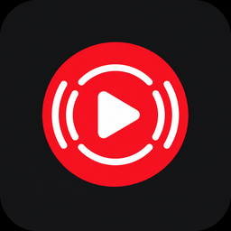

# Music Deck Bridge branding

The official project name is **Music Deck Bridge**. Use its magenta play-disc identity for both the Stream Deck plugin and Chrome extension. Store submissions should use these same generated assets.

The main mark combines a large magenta disc, rounded white play triangle, paired left/right sound waves and a dark rounded square. Shapes are defined in the project renderer. See the [versioned branding history](verification/v1.0.1.md#branding-history) for earlier designs and their provenance.



## Palette and small sizes

The renderer uses these colors. Large exports interpolate the disc gradient and subtly light the dark background; downsampled edges use antialiasing.

| Role | Color |
| --- | --- |
| Primary Magenta — flat 16px/48px disc | `#F72575` |
| Highlight Magenta — large disc, top stop | `#FF38D1` |
| Vivid Magenta — large disc, middle stop | `#FF007D` |
| Deep Magenta — large disc, bottom stop | `#D000A4` |
| Dark Background — flat small exports | `#151923` |
| White — play triangle and sound waves | `#FFFFFF` |

The colored icon has a dark rounded square with transparent outer corners. The category variant is a white disc with transparent triangle and wave cutouts for use on Stream Deck's dark interface. It contains no colored background.

Use the committed size-specific PNGs. The minimum colored size is **16×16**; the minimum monochrome category size is **28×28**. At those sizes the play triangle must remain visible. The 16px icon simplifies the sound waves to one pair; other sizes retain two pairs. Colored 16px/48px exports use flat fills for clarity. Inspect both native size and enlarged pixels when changing geometry; automated pixel checks support this review but do not replace checking the installed UI.

| Destination | Path | Dimensions |
| --- | --- | --- |
| Stream Deck representative icon | `streamdeck/io.github.minjungw00.musicdeckbridge.sdPlugin/imgs/plugin/icon.png`, `icon@2x.png` | 256×256, 512×512 |
| Stream Deck category | `streamdeck/io.github.minjungw00.musicdeckbridge.sdPlugin/imgs/plugin/category.png`, `category@2x.png` | 28×28, 56×56 |
| Chrome representative and toolbar icons | `chrome-extension/icons/16.png`, `48.png`, `128.png` | 16×16, 48×48, 128×128 |
| Chrome Web Store listing icon | `store-assets/chrome/listing/icon-128.png` | 128×128, 96px artwork area and transparent 16px border |
| Marketplace app icon | `store-assets/elgato/app-icon.png`, identical upload copy `store-assets/elgato/listing/app-icon-288.png` | 288×288 |

The 288px Marketplace export uses the same renderer; its size follows the [Marketplace product guidelines](https://docs.elgato.com/guidelines/products/).

The Chrome listing icon is a separate size-normalized export of the same main mark. The [Chrome media renderer](../scripts/render-chrome-store.mjs) prepares it alongside the store screenshots and promotional tile; see the [Chrome upload guide](../store-assets/chrome/README.md#upload-files).

The [Marketplace media renderer](../scripts/render-elgato-store.mjs) copies the canonical 288px app icon and composes a separate 1920×960 thumbnail plus three gallery images. It preserves the approved actual device capture and uses English explanatory text; see the [Marketplace upload guide](../store-assets/elgato/README.md#upload-files).

## Action icons

All ten actions use the main icon's circular badge, gradient magenta, white symbol and dark rounded surface. Now Playing uses the main play-disc mark; the other actions use recognizable playback, speaker/mute, dial, launch and thumb symbols.

| Now Playing | Play / Pause | Previous | Next | Mute | Volume Dial | Current Track Dial |
| --- | --- | --- | --- | --- | --- | --- |
|  |  |  |  |  |  |  |

Each family has a 72px key and 144px @2x key. The 20px/40px action-list badges use white with transparent symbol cutouts so they remain monochrome on Stream Deck's dark UI. All action exports use 4× supersampling before downsampling. The Chrome popup uses the same dark background, a deep-magenta primary button for white-text contrast and a magenta keyboard-focus outline. The property inspector retains the host's neutral SDPI style.

The Play / Pause key has separate artwork for its next operation: Play when paused, Pause while playing. It follows the selected player's confirmed state, including changes made in Chrome, and updates every visible instance of the key. A key press alone does not flip the image. With no selected player it shows Play. Play/Pause, Like, Dislike and Open keys have no default text titles. The action-list icon uses Play.

| Paused: Play | Playing: Pause |
| --- | --- |
|  |  |

Open uses a window-and-arrow glyph. Like and Dislike use outlined thumbs before selection and filled thumbs after the selected player's rating is confirmed. Both use 72px/144px variants and the shared magenta surface.

| Open | Like | Liked | Dislike | Disliked |
| --- | --- | --- | --- | --- |
|  |  |  |  |  |

The [root README thumbnail](../store-assets/elgato/listing/thumbnail-1920x960.png) shares the generated Marketplace design, using the main mark and five action icons. See its [provenance and regeneration guide](assets/README.md). It is promotional artwork rather than a product screenshot.

## Reproduction and validation

From the repository root, with Python 3.10+ and the optional renderer installed:

```sh
python -m pip install Pillow==12.0.0
python streamdeck/generate_assets.py
git diff --exit-code -- chrome-extension/icons streamdeck/io.github.minjungw00.musicdeckbridge.sdPlugin/imgs
```

Use `python3` on systems without a `python` alias. To review regeneration without overwriting tracked PNGs, pass `--output-root /path/to/temporary-output`. The generator defines every shape in a 512-unit coordinate system. Brand shapes are rendered at 4× resolution and downsampled using Lanczos, including the 512px export. The generator takes no external artwork, logo, font or source-image inputs. The pinned Pillow version reproduces the committed PNGs.

Run the normal [development checks](development.md#local-checks). `tests/brand-assets.test.mjs` verifies brand/store PNG dimensions, RGBA data, corner transparency, palette, minimum-size triangle shape and manifest references, plus the 40 base action PNGs' dimensions, palette, distinct symbols and monochrome cutouts and separate playback/rating state artwork at both key sizes, using Node's standard library. Python packaging tests verify that Chrome ZIP and Stream Deck staging preserve the brand and action PNG bytes, including pause and selected-rating images. The generator produces 54 assets, including the store app icon and six additional state PNGs. Pillow is required only for regeneration, not ordinary tests or packaging.

## License and attribution

The project's generator and generated icons are distributed under the repository's [Apache-2.0 license](../LICENSE). Keep applicable [NOTICE](../NOTICE) and [third-party notices](../THIRD_PARTY_NOTICES.md) with redistributions. Bundled third-party code retains its own licenses. This artwork statement does not extend to external album artwork, earlier unverified images or third-party trademarks.

Music Deck Bridge is independent and unofficial. It is not affiliated with or endorsed by Google, YouTube, Elgato or Corsair. Those names identify compatible products and remain their owners' trademarks. These project graphics do not represent store approval. Marketplace and Chrome Web Store install URLs belong in the installation guides only after the respective products are approved and publicly available.
