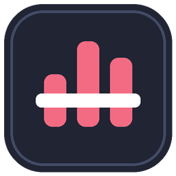

# Music Deck Bridge branding

The official project name is **Music Deck Bridge**. Version 1.0.1 introduces its magenta play-disc identity for both the Stream Deck plugin and Chrome extension. Store submissions should use these same generated assets.

## Icon history

The earlier 0.5.1-era icons used a circular play mark and surrounding arcs. Their source artwork was not independently verified. Commit [`05e1785`](https://github.com/minjungw00/music-deck-bridge/commit/05e17852815d5c0c99f07e83bf01ebc7bcec2dfc) removed the supplied source mark and replaced the brand and action icons with reproducible geometric graphics. The 1.0.0 brand was three equalizer bars joined by a white bridge. Its Now Playing variant remains an action icon.

The 1.0.1 brand follows the maintainer's supplied visual reference: a large magenta disc, rounded white play triangle, paired left/right sound waves and a dark rounded square. The initial unreleased candidate with offset signal bars and a bent bridge connection was rejected in design review and replaced. The revised shapes are defined in project code; the reference bitmap is not bundled or used as a rendering input. This documents the selected design rather than claiming trademark clearance or store approval.

| 1.0.0 geometric brand, introduced by `05e1785` | 1.0.1 magenta play-disc brand |
| --- | --- |
|  |  |

The historical comparison PNG is copied unchanged from the `v1.0.0` tag. It shows the project's generated predecessor, rather than redistributing the earlier unverified artwork. The `v1.0.0` tag and release assets are preserved.

## Palette and small sizes

The renderer uses these colors. Large exports interpolate the disc gradient and subtly light the dark background; downsampled edges use antialiasing.

| Role | Color |
| --- | --- |
| Primary Magenta — flat 16px/48px disc | `#F72575` |
| Highlight Magenta — large disc, top stop | `#FF38D1` |
| Vivid Magenta — large disc, middle stop | `#FF007D` |
| Deep Magenta — large disc, bottom stop | `#D000A4` |
| Dark Background — flat small exports | `#151923` |
| White — play triangle and sound waves | `#FFFFFF` |

The colored icon has a dark rounded square with transparent outer corners. The category variant is a white disc with transparent triangle and wave cutouts for use on Stream Deck's dark interface. It contains no colored background.

Use the committed size-specific PNGs. The minimum colored size is **16×16**; the minimum monochrome category size is **28×28**. At those sizes the play triangle must remain visible. The 16px icon simplifies the sound waves to one pair; other sizes retain two pairs. Colored 16px/48px exports use flat fills for clarity. Inspect both native size and enlarged pixels when changing geometry; automated pixel checks support this review but do not replace checking the installed UI.

| Destination | Path | Dimensions |
| --- | --- | --- |
| Stream Deck representative icon | `streamdeck/io.github.minjungw00.musicdeckbridge.sdPlugin/imgs/plugin/icon.png`, `icon@2x.png` | 256×256, 512×512 |
| Stream Deck category | `streamdeck/io.github.minjungw00.musicdeckbridge.sdPlugin/imgs/plugin/category.png`, `category@2x.png` | 28×28, 56×56 |
| Chrome representative and toolbar icons | `chrome-extension/icons/16.png`, `48.png`, `128.png` | 16×16, 48×48, 128×128 |

The generator handles `brand` separately from `nowplaying`. All seven existing action icon families retain their geometry and colors in this release.

## Reproduction and validation

From the repository root, with Python 3.10+ and the optional renderer installed:

```sh
python -m pip install Pillow==12.0.0
python streamdeck/generate_assets.py
git diff --exit-code -- chrome-extension/icons streamdeck/io.github.minjungw00.musicdeckbridge.sdPlugin/imgs
```

Use `python3` on systems without a `python` alias. To review regeneration without overwriting tracked PNGs, pass `--output-root /path/to/temporary-output`. The generator defines every shape in a 512-unit coordinate system. Brand shapes are rendered at 4× resolution and downsampled using Lanczos, including the 512px export. The generator takes no external artwork, logo, font or source-image inputs. The pinned Pillow version reproduces the committed PNGs.

Run the normal [development checks](development.md#local-checks). `tests/brand-assets.test.mjs` verifies the seven brand PNG dimensions, RGBA data, corner transparency, palette, minimum-size triangle shape and manifest references using Node's standard library. Python packaging tests verify that Chrome ZIP and Stream Deck staging preserve the brand PNG bytes. Pillow is required only for regeneration, not ordinary tests or packaging.

## License and attribution

The project's generator, generated icons and historical geometric comparison PNG are distributed under the repository's [Apache-2.0 license](../LICENSE). Keep applicable [NOTICE](../NOTICE) and [third-party notices](../THIRD_PARTY_NOTICES.md) with redistributions. Bundled third-party code retains its own licenses. This artwork statement does not extend to external album artwork, earlier unverified images or third-party trademarks.

Music Deck Bridge is independent and unofficial. It is not affiliated with or endorsed by Google, YouTube, Elgato or Corsair. Those names identify compatible products and remain their owners' trademarks. These project graphics do not represent store approval. Marketplace and Chrome Web Store install URLs belong in the installation guides only after the respective products are approved and publicly available.
